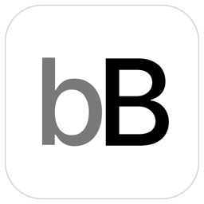
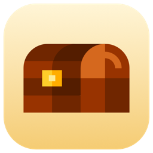

We make small, focused apps for macOS.

<table align="center">
  <tr>
    <td align="center" valign="top" width="50%">
      
      <h3><a href="https://boringbar.app">boringBar</a></h3>
      
A taskbar for macOS. Keeps your windows organized by desktop, with previews, pinned apps and one-click desktop switching.

      
<a href="https://boringbar.app">boringbar.app</a>

    </td>
    <td align="center" valign="top" width="50%">
      
      <h3><a href="https://chest.boringbar.app">Chest</a></h3>
      
A free, open-source menu bar manager for macOS. Hide the menu bar icons you don't need, right in the menu bar or in a drawer.

      
<a href="https://chest.boringbar.app">chest.boringbar.app</a> · <a href="https://github.com/boringbar/chest">Source</a>

    </td>
  </tr>
</table>
